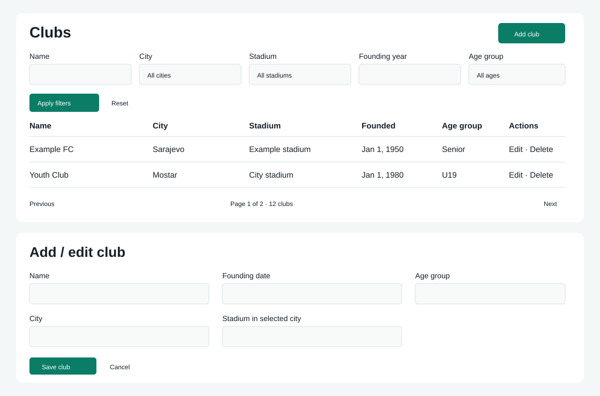

# COMP-13 Club CRUD

Jira: https://rs1-2025-26-live-competiton.atlassian.net/browse/COMP-13

Visitors can browse `/club-list`, apply name/city/stadium/founding-year/age filters, page through results, and open `/club/:slug`. Admins and Moderators use guarded `/manage-clubs` routes; only Admins can delete. The form requires a valid historical founding date and a stadium in the selected city. Names are unique by normalized slug among active clubs. All IDs exposed by the Club API are public IDs.

The mockup uses illustrative data. The implementation includes loading, validation, empty, retry and deletion confirmation states and uses the application's theme variables.

## API

- `GET /api/club?page=1&pageSize=10&name=...&cityId=...&stadiumId=...&foundingYear=1950&clubAge=7`: `PagedResult<ClubResponseDto>`; pageSize 1–100.
- `GET /api/club/{slug}`: details.
- `POST /api/club`: Admin/Moderator; 201 plus Location.
- `PUT /api/club/{slug}`: Admin/Moderator; returns updated details and new slug after rename.
- `DELETE /api/club/{publicId}`: Admin; sets DeletedAt, preserving the database row.

Age groups: 0 U7, 1 U9, 2 U11, 3 U13, 4 U16, 5 U19, 6 U21, 7 Senior. Write body: name, foundingDate (yyyy-MM-dd), clubAge, cityId, stadiumId.

## Scope and integration

Club functionality from the unmerged origin/COMP-13 was adapted to current origin/main. The merge retains current shared infrastructure; the old branch's unrelated infrastructure and geographic-handler changes are intentionally excluded. A fresh additive EF migration creates Clubs with Restrict foreign keys, public ID index, unique active slug and the current NodaTime types.

The Selection → Club FK and selection listings remain COMP-36, which Jira explicitly scopes separately and blocks on COMP-14. Shared regional pipes are tracked in COMP-104 and are not present on the current base; Club views use Angular date/number pipes like the existing views until that dependency lands. This draft does not mark the overall story Done or award merged points.

## Review checklist

- Apply `20261012215350_AddClubEntity` through the application's usual EF migration process.
- Test visitor list/detail, Admin/Moderator forms, validation errors, five filters, paging and Admin-only deletion.
- Review the mockup and pending COMP-36 / COMP-104 dependencies before closing the story.
- Automated HTTP tests use EF InMemory; a live PostgreSQL migration/application smoke test still belongs to review/deployment validation.

## Automated validation results

- .NET 10 solution build: passed. The installed SDK was .NET 8; validation used a workspace-local official SDK 10.0.401.
- `dotnet test CompetitionSolution.sln --no-restore`: **158 passed, 0 failed**, including 20 new Club unit/repository/HTTP cases.
- `npm test -- --watch=false --include='src/app/pages/clubs/*.spec.ts'`: **6 passed, 0 failed**.
- `npm run build`: passed; Club screens emitted as lazy chunks. Existing build reports initial bundle/font size and Leaflet CommonJS warnings.
- `dotnet ef migrations has-pending-model-changes`: no changes since the generated migration.
- Diff reviewed; Club migration is additive and preserves existing tables/configuration.

The backend restore reports an AutoMapper 16.0.0 vulnerability warning and existing nullable-reference warnings; dependency remediation is outside this Club change.
